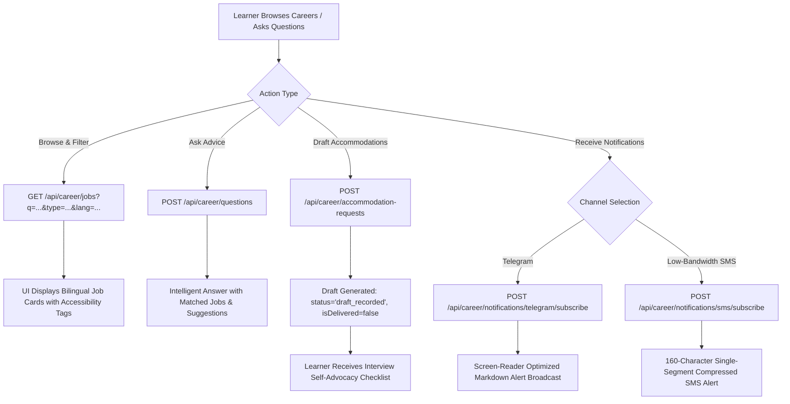

# Voice4All — Career Opportunities, Q&A & Notification Interfaces (Phase 2)

## 1. Overview and Accessibility Principles

The **Voice4All Career Module** bridges Savanna learners with inclusive, remote-first virtual assistant opportunities while equipping them with self-advocacy tools:

1. **Transparent Job Browsing & Multilingual Filtering:** Explores inclusive positions with bilingual metadata (English & Amharic), filtering by work arrangement (`remote`, `fulltime`, `parttime`) and verified accessibility accommodations.
2. **Career Opportunity Q&A:** An intelligent advisory endpoint answering learner inquiries about role requirements, assistive software support, and workplace accommodations.
3. **Interview Accommodation Drafting ("Not Sent" Policy):** 
   > **Do not imply it has been sent to an employer unless actual delivery exists.**
   All accommodation requests are strictly generated as **interview preparation drafts** (`status: "draft_recorded"`). The system provides learners with a structured self-advocacy checklist.
4. **Low-Bandwidth Multi-Channel Notifications:**
   - **Telegram Integration:** Markdown-formatted job broadcasts formatted for screen readers.
   - **SMS Interface:** Concise, single-segment 160-character alerts engineered for feature phones and low-connectivity environments.

---

## 2. Career Architecture & Workflows



---

## 3. Bilingual Sample Job Dataset (`backend/data/jobs.json`)

All sample records are synthetic opportunities designed for demonstration and training:

| Field | Description | Example |
| :--- | :--- | :--- |
| `id` | Unique opportunity identifier | `v4a-job-001` |
| `title` / `title_am` | Role title in English and Amharic | `Executive Virtual Assistant` / `ዋና ሥራ አስፈጻሚ ቨርቹዋል ረዳት` |
| `company` / `organization` | Sample employer name | `AfriTech Global Solutions (Sample)` |
| `location` / `location_am` | Location and time zone details | `Remote (Pan-Africa)` / `የርቀት ሥራ (አፍሪካ አቀፍ)` |
| `type` / `type_label` | Employment type | `fulltime` (`Full-Time` / `ሙሉ ጊዜ`), `parttime`, `remote` |
| `accessible_workplace` | Boolean flag | `true` |
| `accessibilityOrAccommodation` | Full accessibility disclosure | Screen reader verified, captioning for syncs, asynchronous updates |
| `interviewAccommodationsOffered` | Supported interview adaptations | Advance written questions, camera-optional, extended time |
| `isSample` | Simulation transparency flag | Always `true` |

---

## 4. API Reference

### 4.1 `GET /api/career/jobs`
Retrieves sample job listings with flexible filtering and language localization.

#### Query Parameters
- `q` / `search`: Filter by keyword in title, company, description, or tags.
- `type`: Filter by `all`, `remote`, `fulltime`, or `parttime`.
- `location`: Substring search on location.
- `lang`: Localization language (`en` or `am`). When `am`, returns Amharic fields.
- `accessible_only`: Filter only verified accessible workplaces.

#### Example Request
```http
GET /api/career/jobs?q=screen+reader&type=remote&lang=en
```

#### Response (`200 OK`)
```json
{
  "success": true,
  "total": 2,
  "language": "en",
  "isSampleDataset": true,
  "datasetNotice": "SIMULATED SAMPLE OPPORTUNITIES — For accessibility demonstration...",
  "jobs": [
    {
      "id": "v4a-job-001",
      "title": "Executive Virtual Assistant",
      "company": "AfriTech Global Solutions (Sample)",
      "location": "Remote (Pan-Africa)",
      "type": "fulltime",
      "type_label": "Full-Time",
      "tags": ["Remote", "Screen-reader verified", "Flexible hours"],
      "accessible_workplace": true,
      "accessibilityOrAccommodation": "100% remote asynchronous-first team...",
      "interviewAccommodationsOffered": [
        "Advance interview questions provided in writing (24 hours prior)",
        "Live human captions and transcript during video calls",
        "Camera-optional interview format"
      ],
      "isSample": true
    }
  ]
}
```

---

### 4.2 `POST /api/career/questions`
Answers learner questions regarding job opportunities, skills, and accommodations in English or Amharic.

#### Request Body
```json
{
  "question": "Which jobs accommodate screen readers and are 100% remote?",
  "language": "en"
}
```

#### Response (`200 OK`)
```json
{
  "success": true,
  "question": "Which jobs accommodate screen readers and are 100% remote?",
  "language": "en",
  "answer": "We found 2 opportunities with verified screen reader compatibility and accessibility accommodations:\n\n• Executive Virtual Assistant at AfriTech Global Solutions (Remote (Pan-Africa))...\n\nYou can prepare an Interview Accommodation Request draft for any of these roles directly on this platform.",
  "matchedJobsCount": 2,
  "matchingJobIds": ["v4a-job-001", "v4a-job-003"],
  "suggestions": [
    "How do I request interview accommodations?",
    "Which jobs are 100% remote?",
    "Tell me about the Accessibility QA role"
  ],
  "isSample": true
}
```

---

### 4.3 `POST /api/career/accommodation-requests`
Drafts an interview or workplace accommodation request.

#### Request Body (supports Member 1 frontend and Phase 1 schemas)
```json
{
  "job_id": "v4a-job-001",
  "job_title": "Executive Virtual Assistant",
  "accommodations": [
    "Advance interview questions provided in writing (24 hours prior)",
    "Live captions and transcript during video calls",
    "Camera-optional interview format"
  ],
  "details": "Enables optimal verbal participation and prevents visual fatigue.",
  "contact_email": "amara.learner@example.org",
  "language": "en"
}
```

#### Response (`201 Created`)
```json
{
  "success": true,
  "draftId": "ACC-2026-8921",
  "request_id": "ACC-2026-8921",
  "status": "draft_recorded",
  "isDelivered": false,
  "deliveryStatus": "NOT_SENT_DRAFT_ONLY",
  "deliveryNotice": "DRAFT ONLY: This accommodation request is saved locally as an interview self-advocacy draft. It has NOT been sent to the employer. Voice4All provides preparation and drafting tools; actual submission requires external recruiter coordination.",
  "interviewChecklist": [
    "Review your requested accommodations with your career mentor or peer coach.",
    "Send this written draft to your employer recruiter or interview coordinator at least 48 hours prior to the conversation.",
    "Test your assistive software (screen reader, captions, or speech-to-text) on the video platform before the interview.",
    "Prepare 2-3 examples of how you deliver excellent VA work using your accommodations."
  ],
  "draft": { ... }
}
```

---

### 4.4 Telegram Integration Endpoints

- `POST /api/career/notifications/telegram/subscribe`:
  Registers learner chat ID and notification preferences.
- `POST /api/career/notifications/telegram/broadcast`:
  Dispatches screen-reader formatted Markdown alerts.
- `GET /api/career/notifications/telegram/status`:
  Returns integration status and mode (`live_gateway` if `TELEGRAM_BOT_TOKEN` set; otherwise `simulated_demo`).

---

### 4.5 SMS-Compatible Notification Interface

- `POST /api/career/notifications/sms/preview`:
  Returns exact SMS text, character count, and verifies single-segment (≤ 160 characters) GSM-7 compliance.
- `POST /api/career/notifications/sms/subscribe`:
  Subscribes a mobile number for feature-phone SMS job alerts.
- `POST /api/career/notifications/sms/send`:
  Simulates SMS alert delivery with delivery timestamp and segment count.

---

## 5. Documentation of Incomplete & Simulated Functionality

| Capability | Current Implementation Status | Production Roadmap |
| :--- | :--- | :--- |
| **Job Browsing & Multilingual Filtering** | **Fully Functional:** Filter by keyword, category, location, and English/Amharic languages. | Real-time synchronization with external applicant tracking systems (ATS). |
| **Career Guidance Q&A** | **Fully Functional:** Analyzes job dataset and generates structured guidance in English and Amharic. | Augment with live LLM embeddings for deeper semantic matching. |
| **Interview Accommodation Drafting** | **Fully Functional:** Drafts requests with `isDelivered: false` and produces self-advocacy preparation checklists. | Optional encrypted email dispatch with learner confirmation. |
| **Telegram Job Alerts** | **Functional with Simulated Fallback:** Complete Markdown formatting and subscription management. If `TELEGRAM_BOT_TOKEN` is present in `.env`, dispatches live to Telegram Bot API; otherwise operates in simulated mode. | Set up webhook receiver for interactive Telegram bot inline keyboards. |
| **Low-Bandwidth SMS Delivery** | **Simulated Gateway:** Formatter enforces 160-char GSM-7 single-segment constraints and calculates UCS-2 multi-segment payloads. Real cellular delivery is simulated. | In production, plug into Twilio or Africa's Talking SMS API gateway using production API credentials. |
