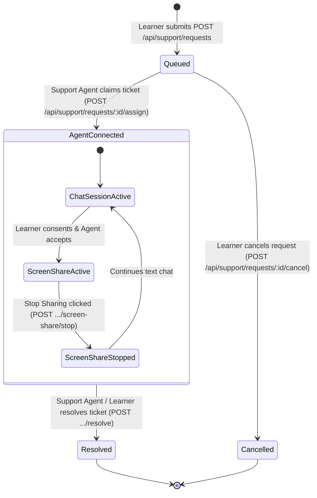

# Voice4All — Human Support Workflow & Consent Architecture (Phase 2)

## 1. Overview & Operational Principles

The **Voice4All Human Support Module** connects Savanna learners with course mentors, peer coaches, and accessibility specialists while upholding strict privacy and transparency standards:

1. **Active Request Queue & Status Tracking:** Real-time queue tracking transitions tickets through transparent states (`queued` -> `in_review` -> `agent_connected` -> `resolved` / `cancelled`).
2. **Strict Honest Human Connectivity Policy:**
   > **Never claim a human is connected unless one actually is.**
   While a ticket is waiting in queue, `humanConnected` is strictly `false` and `screen_share_active` is strictly `false`. No simulated agent is falsely presented as a live human.
3. **Learner-Consented Screen Sharing & Clear Stop Control:** Screen capture requires explicit, affirmative learner consent. A local screen preview is not a live connection. Learners and agents have an immediate, one-click **Stop Sharing** control.
4. **Support-Person Interface:** A dedicated, accessible dashboard allows support staff to triage incoming requests, review learner course context, join sessions, and manage screen-sharing permissions.

---

## 2. End-to-End Support Lifecycle & State Machine



### State Definitions
| State | `humanConnected` | `screen_share_active` | Description |
| :--- | :---: | :---: | :--- |
| `queued` | `false` | `false` | Learner submitted request; placed in active queue with dynamic wait time estimation. |
| `in_review` | `false` | `false` | Agent is reviewing ticket and course context prior to joining. |
| `agent_connected` | **`true`** | `false` | Real support specialist has claimed the ticket and is active in the session. |
| `session_active` | **`true`** | **`true`** | Explicitly consented screen sharing is actively running between learner and agent. |
| `stopped` | **`true`** | `false` | Screen sharing terminated via the Stop-Sharing control; text communication continues. |
| `resolved` | `false` | `false` | Issue concluded with resolution notes. |
| `cancelled` | `false` | `false` | Ticket withdrawn by learner. |

---

## 3. Screen Sharing Consent & Stop-Sharing Controls

### 3.1 Affirmative Consent Protocol
- When a learner selects *Screen Share* mode, their browser opens a local media stream (`getDisplayMedia`).
- **Transparency Rule:** The local preview is rendered strictly inside the learner's own browser. No video frames are transmitted over the network until:
  1. The learner checks an explicit affirmative consent box (`screenShareConsent: true`).
  2. A human support agent explicitly joins the session (`humanConnected: true`).
- If screen sharing is requested without consent, the backend rejects the request with HTTP `400 Bad Request`.

### 3.2 Clear Stop-Sharing Control
Learners and support agents have immediate access to stop screen transmission at any time:
- **Learner Stop Button:** Available on the floating learner drawer and active ticket card.
- **Agent Stop Button:** Available on the support-person dashboard.
- **Endpoint:** `POST /api/support/requests/:id/screen-share/stop` (or global `POST /api/support/screen-share/stop`).
- **Immediate Effect:** Sets `screen_share_active: false` and `screenShareStatus: "stopped"`, broadcasts status update, and appends an audit event to the ticket history.

---

## 4. Support-Person Interface

Support staff interact with the queue via:
1. **Interactive Web Dashboard:** `GET /api/support/dashboard` (or `pages/support-dashboard.html`)
   - Real-time queue metrics: *Waiting in Queue*, *Human Connected*, *Screen Share Sessions*, *Resolved*.
   - Urgency badges (`HIGH`, `NORMAL`, `LOW`) and channel badges (`chat`, `screen_share`).
   - Deep inspection of learner's Savanna course context (`courseTitle`, `moduleTitle`, `lessonTitle`).
   - One-click actions: *Claim & Connect Live*, *Stop Screen Share*, and *Mark Resolved*.
2. **REST API Endpoints:** Complete programmatic control for headless or integrated helpdesk tools.

---

## 5. API Reference

### 5.1 `POST /api/support/requests`
Creates a new support ticket and enqueues it.

#### Request Body
```json
{
  "topic": "Screen Navigation Help",
  "message": "I cannot locate the recap quiz button on my screen.",
  "preferred_mode": "screen_share",
  "urgency": "high",
  "language": "en",
  "context": {
    "courseTitle": "VA-1: VA Foundations & Professional Identity",
    "moduleTitle": "Module 2: What is a VA",
    "lessonTitle": "The Future of the VA Industry"
  },
  "consent": {
    "screenShareRequested": true,
    "screenShareConsent": true
  }
}
```

#### Response (`201 Created`)
```json
{
  "success": true,
  "requestId": "REQ-2026-4821",
  "request_id": "REQ-2026-4821",
  "status": "queued",
  "humanConnected": false,
  "screen_share_active": false,
  "connectionNotice": "You are currently in the queue. No human agent is currently connected.",
  "isSimulated": true,
  "simulationNotice": "SIMULATED SUPPORT WORKFLOW: This ticket is managed by the Voice4All demonstration support queue...",
  "estimated_wait_minutes": 2,
  "ticket": { ... }
}
```

---

### 5.2 `GET /api/support/requests/:id`
Returns current ticket status, queue position, and honest human connection status.

#### Response (`200 OK`)
```json
{
  "success": true,
  "requestId": "REQ-2026-4821",
  "status": "queued",
  "humanConnected": false,
  "screen_share_active": false,
  "agentName": null,
  "queuePosition": 1,
  "estimatedWaitMinutes": 2
}
```

---

### 5.3 `GET /api/support/queue`
Retrieves all tickets and summary statistics for support personnel.

#### Response (`200 OK`)
```json
{
  "success": true,
  "stats": {
    "totalTickets": 4,
    "queued": 2,
    "inReview": 0,
    "agentConnected": 1,
    "resolved": 1,
    "screenShareActive": 0
  },
  "queue": [ ... ]
}
```

---

### 5.4 `POST /api/support/requests/:id/assign`
Support agent claims ticket and initiates real human connection.

#### Request Body
```json
{
  "agentName": "Mentor Grace (Support Specialist)",
  "agentId": "agent-grace"
}
```

#### Response (`200 OK`)
```json
{
  "success": true,
  "message": "Support agent Mentor Grace (Support Specialist) successfully connected to ticket.",
  "humanConnected": true,
  "screen_share_active": true,
  "ticket": { ... }
}
```

---

### 5.5 `POST /api/support/requests/:id/screen-share/stop`
Clear stop-sharing control. Terminates screen sharing immediately.

#### Request Body
```json
{
  "stoppedBy": "learner"
}
```

#### Response (`200 OK`)
```json
{
  "success": true,
  "requestId": "REQ-2026-4821",
  "screenShareStatus": "stopped",
  "screen_share_active": false,
  "stoppedBy": "learner",
  "message": "Screen sharing has been successfully stopped. No screen content is being transmitted."
}
```

---

### 5.6 `POST /api/support/requests/:id/resolve`
Marks ticket resolved with resolution notes.

---

## 6. Documentation of Incomplete & Simulated Functionality

| Capability | Current Implementation Status | Production Roadmap |
| :--- | :--- | :--- |
| **Support Queue & State Machine** | **Fully Functional:** In-memory queue tracks tickets, wait calculations, assignments, and resolution notes. | Migrate in-memory map to Redis / PostgreSQL for persistence across server restarts. |
| **Honest Connectivity Flags** | **Fully Enforced:** Strictly verifies `humanConnected: false` until an agent joins. | Real agent SSO authentication via OAuth2/OIDC. |
| **Stop-Sharing Controls** | **Fully Enforced:** API and UI controls immediately terminate session and state. | Integrated with WebRTC `track.stop()` in frontend browser client. |
| **WebRTC Media Server** | **Simulated Signaling:** Status transitions, permission handshakes, and screen state signaling are fully implemented. Live peer-to-peer video streaming is simulated. | In production, integrate an SFU (Selective Forwarding Unit) such as LiveKit or mediasoup with TURN relays for NAT traversal. |
